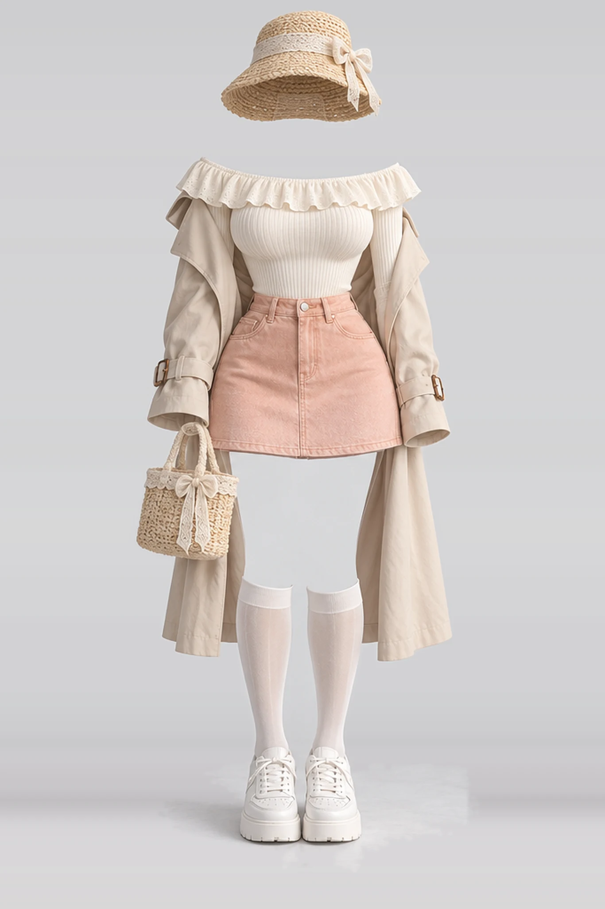

# 服装集图库 · COSTUME-DB-01

> 仓库名：`AI-Clothing-Resource-Library`

一个纯静态的**服装参考图库**：1407 张不含人物的 AI 生成服装图，按季节与风格分类，支持搜索、手动上传、自定义分类、编辑与一键生成文生图提示词。



- 无构建、无依赖、无后端：一个 `index.html` + 一个 `assets/` 目录
- 支持 `file://` 直接双击打开，也能部署到任意静态托管
- 上传的图片与坐标数据存在**浏览器本地**（IndexedDB / localStorage），不上传服务器

---

## 功能

### 浏览
- 8 个内置分类：春 215、夏 254、秋 244、冬 253、内衣 199、派对 48、泳装 54、性感 140
- 分类栏计数实时统计；支持分页加载（每次 120 张）与「查看更多」
- 搜索编号或关键词，支持中英文（如 `牛仔`、`lace`、`白色`、`SPR-0001`）
- 卡片 → 放大查看 1366×2048 原图，`←/→` 切换，`Esc` 关闭，可下载原图

### 上传与编辑（数据保存在本机浏览器）
- 「上传服装」支持拖拽 / 多选，JPG / PNG / WebP / HEIC 均可
- 每张图片**必须**选择分类并填写关键词，缺失会用红框标出并阻止保存
- 编号按所属分类累加：`SPR-0261`、`SUM-0261`…（序号独立计数，删除后不回退，不会重号）
- 新增自定义分类时可指定编号前缀（如 `JJ`），留空自动生成并去重
- 上传的图片可修改分类 / 关键词（改分类会按新分类重新编号），也可删除；内置图片只读
- 图片经 canvas 压缩生成缩略图（640px WebP）后存入 IndexedDB，失败自动回退 localStorage

### AI 提示词（可选，需自备 DeepSeek API Key）
- 点开任意图片 → 右侧「AI 提示词」→「生成」，按该服装的分类与关键词生成一条 60–90 词的英文文生图提示词
- 可手动修改、复制、自动保存；已有提示词的卡片左下角显示 `AI` 角标
- 提示词模板（system prompt）可在设置里自定义，方便固化自己的出图风格
- 接口为 OpenAI 兼容格式，默认 `https://api.deepseek.com` + `deepseek-flash`，改接口地址即可接其他兼容服务

---

## 快速开始

**方式一：直接打开**

双击 `index.html` 即可。上传的图片和设置会保存在这个文件对应的浏览器存储里。

**方式二：本地起个静态服务器（推荐）**

```bash
cd AI-Clothing-Resource-Library
python3 -m http.server 8080
# 打开 http://localhost:8080
```

> 注意：`file://` 与 `http://localhost` 属于**不同来源**，两者的 IndexedDB / localStorage 互不共享。上传过图片后请固定用同一种方式打开，否则会「看不到之前上传的图」。

**方式三：部署到静态托管**

仓库是纯静态文件，直接部署即可：

| 平台 | 做法 |
| --- | --- |
| GitHub Pages | Settings → Pages → Deploy from branch，选 `main` / root |
| Cloudflare Pages | 直接连仓库，构建命令留空，输出目录 `/` |
| Vercel / Netlify | 同上，无框架、无构建 |

> 仓库含 `assets/` 约 129 MB（1407 张原图 + 缩略图），首次 clone 会稍慢。如需减小体积，可用 Git LFS 管理 `assets/img/`。

---

## 目录结构

```
.
├── index.html          # 全部样式、逻辑与内置数据（单文件应用）
├── assets/
│   ├── img/            # 原图 1366×2048 WebP（1407 张，约 116 MB）
│   └── thumbs/         # 缩略图 360×540 WebP（约 13 MB）
├── LICENSE             # 代码：MIT
├── LICENSE-IMAGES.txt  # 图片数据：CC BY 4.0
└── README.md
```

## 数据结构

内置数据是 `index.html` 里的一个数组：

```js
const D = [{
  id: "SPR-0001",
  "カテゴリ": "春",
  "キーワード": "ivory frill knit denim mini skirt coat socks white sneakers",
  "サムネ": "assets/thumbs/SPR-0001.webp",
  "画像":   "assets/img/SPR-0001.webp",
  "原寸":   "assets/img/SPR-0001.webp"
}, /* ... */];
```

| 字段 | 说明 |
| --- | --- |
| `id` | 编号，`分类前缀-四位序号` |
| `カテゴリ` | 分类名（内置：春/夏/秋/冬/内衣/派对/泳装/性感） |
| `キーワード` | 空格分隔的英文标签，用于搜索与 AI 提示词，中文标签见 `TAG_ZH` |
| `サムネ` / `画像` / `原寸` | 缩略图 / 展示图 / 下载原图路径 |

想批量加入自己的图：把 WebP 放进 `assets/img/` 与 `assets/thumbs/`，再往 `D` 里追加对应条目即可（`META.total` / `META.counts` 只用于初始展示，分类计数已改为实时统计）。

---

## 隐私与安全

- **没有任何埋点、统计、外部字体或 CDN 请求**：页面加载的资源全部来自本地 `assets/`
- 上传的图片、分类、提示词、AI 设置都只存在浏览器本地（IndexedDB / localStorage），不会上传到任何服务器
- DeepSeek API Key 以明文保存在浏览器 `localStorage`，仅在你点「生成」时随请求发往你填写的接口地址；请勿在公共电脑填写
- 想彻底清空本地数据：浏览器开发者工具 → Application → 清除本站点的 IndexedDB / Local Storage

---

## 授权

- **代码**：MIT，见 [LICENSE](LICENSE)
- **图片数据**（`assets/`）：CC BY 4.0，见 [LICENSE-IMAGES.txt](LICENSE-IMAGES.txt) —— 可自由使用、修改、再分发与商业使用，保留署名即可

图片均为 AI 生成的虚构服装，不含真实人物与真实商品；发布前已检查与现有品牌的相似性，但不保证不侵犯第三方权利，使用者请自行核实并承担相应判断。

---

## 更新记录

- 2026-10：加入手动上传、自定义分类、按分类累加的编号、图片编辑与删除
- 2026-10：接入 DeepSeek，为单张图片生成文生图提示词；移除全部外部 CDN 依赖
